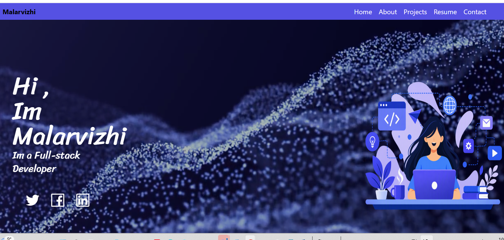
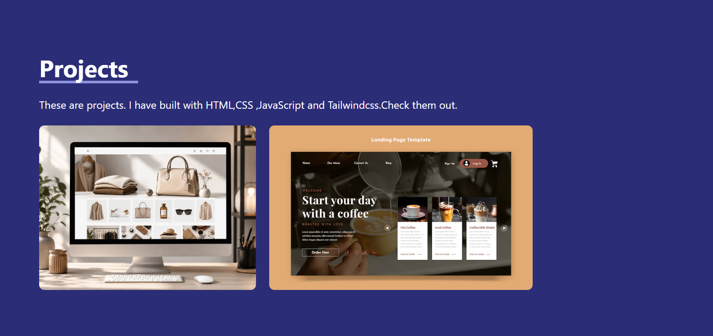
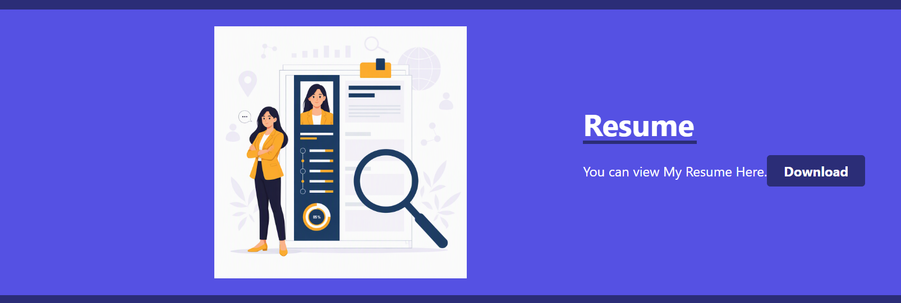

# Portfolio Website

A personal portfolio website created to showcase my skills, projects, education, certifications, and contact information. This website serves as an online professional profile and demonstrates my web development skills.

## 🌐 Live Demo

🔗 https://malar172.github.io/portfolio1/

## 📂 GitHub Repository

🔗 https://github.com/malar172/portfolio1

## ✨ Features

- Responsive Design
- About Me Section
- Skills Showcase
- Projects Gallery
- Education Details
- Certifications Section
- Contact Information
- Modern and Clean User Interface

## 🛠️ Technologies Used

- HTML5
- CSS3
- JavaScript
- GitHub Pages
- Visual Studio Code

## 📂 Project Structure

```text
portfolio1
│
├── index.html
├── style.css
├── script.js
├── assets
│   ├── images
│   └── icons
│
└── README.md

🎯 Purpose

The main purpose of this project is to:

Showcase my personal portfolio online.
Highlight my skills and achievements.
Present completed projects professionally.
Improve my frontend development skills.
🚀 Installation
Clone the repository:
Shell
git clone https://github.com/malar172/portfolio1.git
 
Open the project folder.
Run index.html in a browser or use Live Server in VS Code.
📸 Screenshots

Add screenshots of:
### Home Page


### Project Page


### Resume Page


📚 What I Learned

Through this project, I learned:

Responsive Web Design
HTML Structure
CSS Styling
JavaScript Basics
UI/UX Design Principles
GitHub Deployment
👩‍💻 Author

Malarvizhi Raju

GitHub: https://github.com/malar172

Portfolio: https://malar172.github.io/portfolio1/

📄 License

This project is created for educational and portfolio purposes.
